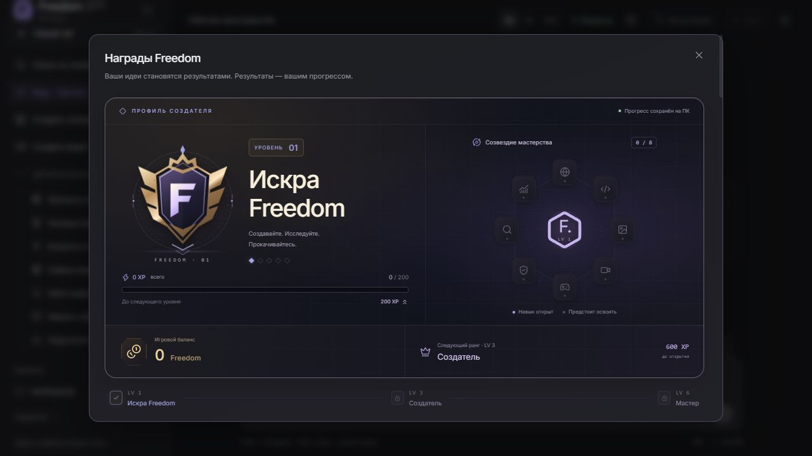
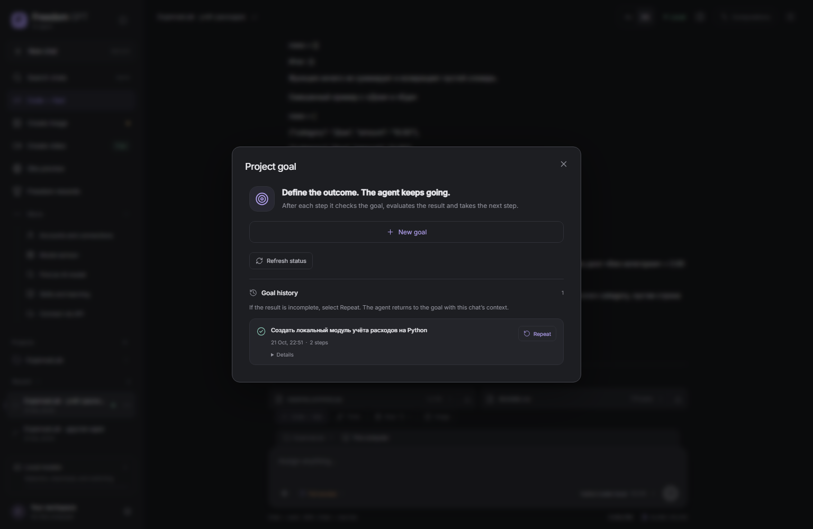
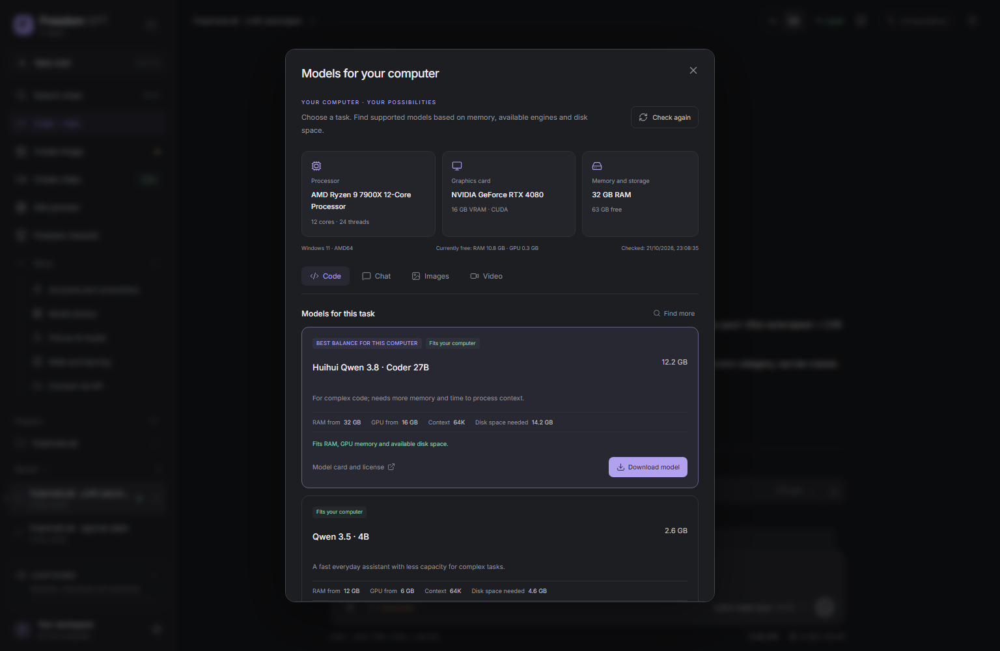
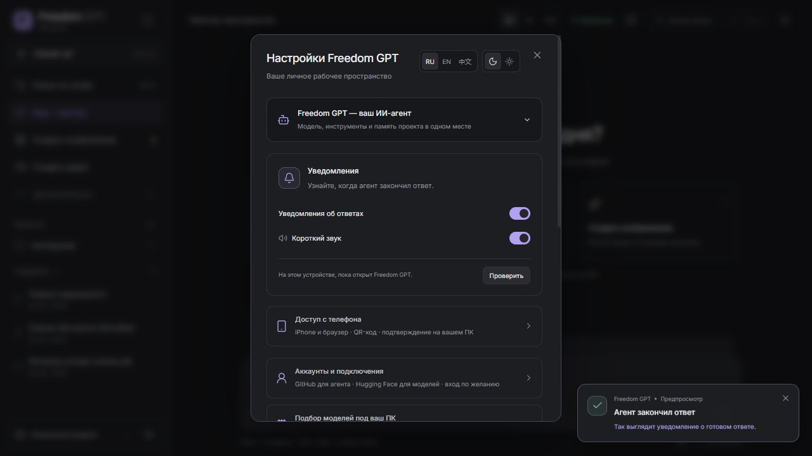

# Freedom GPT · Your AI agent. Your computer.

 

[Русский](README.ru.md) · **English**

> **Coming next: Freedom GPT 1.6.0.** The screenshots and feature tour below show the new Windows preview. Public downloads currently remain on **1.4.2**, which does not include all of these features. New installers and source are being prepared for publication.

Freedom GPT brings compatible models, tools and project memory together. Delegate an outcome: the agent can edit real files, run commands, work with websites and continue a project within one chat.

**Free and open source.** Local inference has no subscription or per-token charge from Freedom GPT. External APIs have their own pricing and models have separate licenses.

[🌐 Website and downloads](https://aionpc.ru/en/) · [⬇ Latest release](https://github.com/Leongrupp/freedom-gpt/releases/latest) · [💬 Telegram](https://t.me/AI1rus)

## Your computer works. Your phone keeps you connected.

Put Freedom GPT on your own computer: build a website, review files, explore ideas or create visuals. In the new version, pair your iPhone or Android browser, watch the same chats and send a task while your PC stays on. No App Store installation or mandatory account.

[Phone pairing guide](docs/PHONE-ACCESS.md) · [Complete feature tour](docs/FEATURES.md)

### Create something. Earn your next level.

A first site, a generated image, a million processed model tokens: achievements turn work into a creator profile with XP, ranks and a skill constellation. New confirmed results keep adding to your counters. Games, code, content, SEO, research, analysis and authorized security work have their own paths. **Freedom points are local game rewards, not cryptocurrency or a promise of future income.**

## What the agent can do

- **Code and projects.** Build websites and applications: the agent reads and edits files, uses the terminal and runs available checks.
- **Goals and task queue.** Define an outcome and acceptance criteria. Queue follow-up tasks and steer the current task with an urgent correction.
- **Branches and memory.** Branch directly from a reply. Keep its conversation and files with a fresh empty queue. Project notes stay on disk.
- **Browser beside the chat.** The preview opens while the agent works with a page. Review its actions and results; installed tools can also use ordinary browsers.
- **Multiple models in one chat.** Choose models yourself or allow automatic selection for different stages: scripts, images, video and code.
- **Local models and APIs.** Import a compatible GGUF or connect supported APIs. GitHub and Hugging Face sign-in are optional.
- **Models for your hardware.** CPU, RAM, GPU and disk checks help select a model. Interrupted downloads resume and SHA256 hashes verify the files.
- **Images and video.** View generated media previews in chat. Local generation needs separate models; cloud video supports fal.ai.
- **Measured Turbo mode.** Compare engine settings on this computer and save an acceleration profile when it helps. Switching waits for an idle model.
- **Context and reasoning.** Select an available context window and supported reasoning depth. Larger contexts need more memory and may be slower.
- **Recovery after tool loops.** Full access permits up to three automatic continuations with instructions to change strategy. Unchanged repetitions are blocked; Stop remains effective.
- **Phone companion.** Enable access in Settings and pair a phone with a QR code. Use chats, files and tasks in the browser while your computer stays on.
- **Achievements and levels.** Earn achievements, activity counts, XP and Freedom game points. These are local rewards, not an issued cryptocurrency.
- **Three languages, compact controls.** Русский, English and 中文, compact settings, light and dark themes. Additional tools live in one expandable menu.

- **Ready-reply notifications.** A card in the lower right and a soft short chime. Open the finished chat from the card; control notifications and sound separately on each device. On phones, the agent page must be open.

## Current public downloads

| System | Download | Requirements |
|---|---|---|
| Windows | [EXE](https://github.com/Leongrupp/freedom-gpt/releases/download/v1.4.2/FreedomGPT-Setup-1.4.2.exe) · [ZIP](https://github.com/Leongrupp/freedom-gpt/releases/download/v1.4.2/FreedomGPT-1.4.2-Windows-x64.zip) | Windows 10/11 x64 |
| Ubuntu / Linux | [.run](https://github.com/Leongrupp/freedom-gpt/releases/download/v1.4.2/FreedomGPT-Setup-1.4.2-Ubuntu-x64.run) · [DEB](https://github.com/Leongrupp/freedom-gpt/releases/download/v1.4.2/FreedomGPT-1.4.2-Ubuntu-amd64.deb) · [TAR.GZ](https://github.com/Leongrupp/freedom-gpt/releases/download/v1.4.2/FreedomGPT-1.4.2-Ubuntu-x64.tar.gz) | Ubuntu 24.04+ x64 / compatible glibc 2.39+ |
| macOS | [Apple Silicon .app ZIP](https://github.com/Leongrupp/freedom-gpt/releases/download/v1.4.2/FreedomGPT-1.4.2-macOS-AppleSilicon.zip) | M1+, macOS 26.2+; unsigned / not notarized |
| iPhone / Android | [Phone pairing](docs/PHONE-ACCESS.md) | 1.6.0 preview: phone browser + an active computer |

**Private Python, Node.js/npm, agent libraries and inference engines are included.** System Python and Ollama are not required. Download model weights separately. Git, automation browsers, Blender and specialist tools are separate installations.

[Installation guide](INSTALL.md) · [Verification and limits](VERIFICATION.md) · [SHA256 checksums](https://github.com/Leongrupp/freedom-gpt/releases/latest/download/SHA256SUMS.txt)

## Panels and workflow

| Goals and completion history | Hardware and models |
|---|---|
|  |  |

The captures above show the actual Windows app using the neutral ExpenseLab project. See the new 1.6.0 panels below. [Capture details](docs/SCREENSHOTS.md).

## Start in three steps

1. Install the package for your system on an SSD.
2. Let the hardware check finish; download a suitable model or connect an API.
3. Select a project folder and describe your task. Configure permissions for external actions.

## Memory, speed and control

Turbo measures settings on your hardware. There is no universal 100-token/s or acceleration guarantee. Context is bounded by the model and available memory: a larger window may offload work to RAM and reduce speed. Reasoning depth and context size are separate controls.

History and project memory stay on disk. Memory is finite; exact files, Git and backups remain authoritative. Websites, downloads and APIs need internet. Update checks and downloads start with the update button; signed installation waits for idle tasks.

### Personal Windows experiments

The developer’s local Windows profile also has optional local speech, voice cloning and camera/avatar experiments. They are being developed separately and are not claimed as included in the current public installer.

## Community and development

The project is growing around a free local agent: broader model compatibility, reliable tools and easier computer/phone workflows. Freedom game points are not currently cryptocurrency and carry no promise of exchange or returns.

[Contributing](CONTRIBUTING.md) · [Support](SUPPORT.md) · [Security](SECURITY.md) · [Build](BUILD.md)

Optional development support: [project page](https://aionpc.ru/en/#support). The application remains free.

## Licenses

Freedom GPT source is MIT-licensed. Hermes and other components retain their licenses and attribution. See [NOTICE](NOTICE), [LICENSE](LICENSE) and [licenses](licenses). Clean packages exclude the author’s chats, credentials, model weights and private profile.
