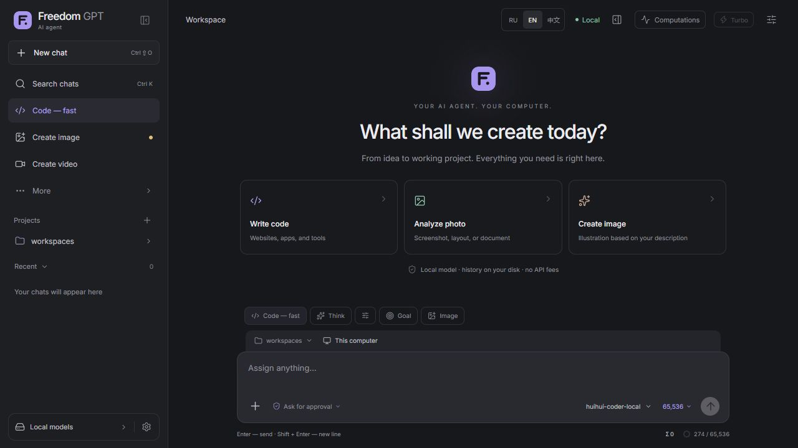
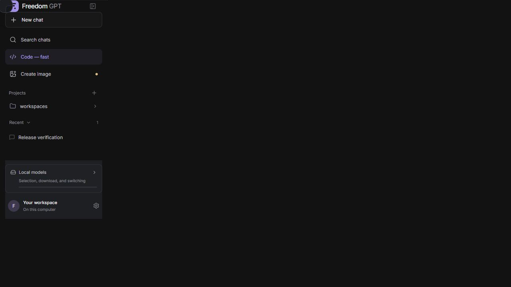

<p align="center"></p>

<h1 align="center">Freedom GPT 💛</h1>
<p align="center"><strong>A free local AI workspace. Your models, your projects, your computer.</strong></p>
<p align="center"><a href="https://aionpc.ru">🌐 Website</a> · <a href="https://github.com/Leongrupp/freedom-gpt/releases/latest">⬇ Downloads</a> · <a href="README.ru.md">🇷🇺 Русский</a> · <a href="https://t.me/AI1rus">💬 Telegram support</a></p>
<p align="center"><a href="LICENSE"></a> <a href="https://github.com/Leongrupp/freedom-gpt/releases"></a> </p>

<p align="center"><strong>Free to download. Free to use. Choose your platform.</strong></p>
<table><tr>
<td width="33%" align="center"><br><strong>Windows</strong><br><sub>Windows 10 / 11 · x64</sub><br><br><a href="https://github.com/Leongrupp/freedom-gpt/releases/download/v1.4.2/FreedomGPT-Setup-1.4.2.exe">Download EXE ↗</a><br><a href="https://github.com/Leongrupp/freedom-gpt/releases/download/v1.4.2/FreedomGPT-1.4.2-Windows-x64.zip">Portable ZIP</a></td>
<td width="33%" align="center"><br><strong>macOS · Preview</strong><br><sub>Apple Silicon · macOS 26.2+</sub><br><br><a href="https://github.com/Leongrupp/freedom-gpt/releases/download/v1.4.2/FreedomGPT-1.4.2-macOS-AppleSilicon.zip">Download app ZIP ↗</a><br><sub>Unsigned; native Mac run not yet verified.</sub></td>
<td width="33%" align="center"><br><strong>Ubuntu Linux</strong><br><sub>Ubuntu 24.04 · x64</sub><br><br><a href="https://github.com/Leongrupp/freedom-gpt/releases/download/v1.4.2/FreedomGPT-Setup-1.4.2-Ubuntu-x64.run">Download installer ↗</a><br><a href="https://github.com/Leongrupp/freedom-gpt/releases/download/v1.4.2/FreedomGPT-1.4.2-Ubuntu-amd64.deb">DEB</a> · <a href="https://github.com/Leongrupp/freedom-gpt/releases/download/v1.4.2/FreedomGPT-1.4.2-Ubuntu-x64.tar.gz">TAR.GZ</a></td>
</tr></table>
<p align="center">Need a hand? <a href="https://t.me/AI1rus">Telegram @AI1rus</a> · Explore <a href="https://aionpc.ru">aionpc.ru</a> · Help the project grow with a star 💛</p>

[📘 Step-by-step installation, automatic terminal commands and first model](INSTALL.md)

## 🏠 Your AI on your computer

Freedom GPT is a free, MIT-licensed local AI workspace for compatible models. Local inference requires no paid API, subscription or per-token payment. You provide hardware, electricity and storage; models and components keep their own licenses. Downloaded models can run offline. Web tools and new downloads require internet.

**Practical guides:** [Windows](https://aionpc.ru/en/install/windows/) · [Ubuntu Linux](https://aionpc.ru/en/install/ubuntu/) · [Mac preview](https://aionpc.ru/en/install/macos/) · [How offline AI works](https://aionpc.ru/en/guides/local-ai/) · [Choose a model for your hardware](https://aionpc.ru/en/guides/choose-model/).

This independent project does not provide free access to proprietary cloud models. Quality and speed depend on the model and hardware.

## ✨ What you can do

- Chat locally, stream code, attach files and analyze photos with a compatible vision model.
- Keep chats, project folders and coding continuity on your disk.
- See generation speed, RAM, VRAM and GPU activity.
- Check your hardware, find models on Hugging Face or the public Ollama registry, and choose what to download.
- Resume interrupted downloads and verify model SHA256 hashes.
- Generate images with a separate Qwen Image model pack. Video Studio is **experimental** and still being tested.
- Use English or Russian and receive signed updates between tasks.

**Private Python, agent libraries, Node.js/npm and inference engines are included.** No preinstalled Python, Ollama or paid API is needed for local chat. Model weights download separately. GPU drivers and optional specialist tools are managed separately.

### A look inside



<sub>Actual first-run screen on an example PC. The hardware shown is not a minimum requirement for every model.</sub>

## ⬇ Choose your system

| Platform | Download | Requirements and status |
|---|---|---|
| Windows | [EXE installer](https://github.com/Leongrupp/freedom-gpt/releases/download/v1.4.2/FreedomGPT-Setup-1.4.2.exe) · [Portable ZIP](https://github.com/Leongrupp/freedom-gpt/releases/download/v1.4.2/FreedomGPT-1.4.2-Windows-x64.zip) | Windows 10/11 x64; verified on Windows 11 |
| Ubuntu Linux | [`.run` installer](https://github.com/Leongrupp/freedom-gpt/releases/download/v1.4.2/FreedomGPT-Setup-1.4.2-Ubuntu-x64.run) · [DEB](https://github.com/Leongrupp/freedom-gpt/releases/download/v1.4.2/FreedomGPT-1.4.2-Ubuntu-amd64.deb) · [TAR.GZ](https://github.com/Leongrupp/freedom-gpt/releases/download/v1.4.2/FreedomGPT-1.4.2-Ubuntu-x64.tar.gz) | Ubuntu 24.04 x64; clean offline container and Linux CUDA smoke tests |
| macOS candidate | [Apple Silicon `.app` ZIP](https://github.com/Leongrupp/freedom-gpt/releases/download/v1.4.2/FreedomGPT-1.4.2-macOS-AppleSilicon.zip) | **M1+, macOS 26.2+.** Unsigned, not notarized; native Mac execution is not yet verified. Intel Mac is not included. |

[All releases and notes](https://github.com/Leongrupp/freedom-gpt/releases) · [SHA256 checksums](https://github.com/Leongrupp/freedom-gpt/releases/latest/download/SHA256SUMS.txt) · [Source](https://github.com/Leongrupp/freedom-gpt/releases/latest)

### Windows — easiest way

Run the EXE, choose English/Russian and an empty SSD folder, then open **FreedomGPT.exe**. The first-run check suggests models for your hardware. Download and verify a model, activate it and start a chat.

Prefer a terminal? Open PowerShell in your chosen download folder:

```powershell
curl.exe -fL -C - --retry 4 -o FreedomGPT-Setup.exe https://github.com/Leongrupp/freedom-gpt/releases/download/v1.4.2/FreedomGPT-Setup-1.4.2.exe
.\FreedomGPT-Setup.exe
```

### Ubuntu — no Python installation

```sh
curl -fL -C - --retry 4 -o FreedomGPT.run https://github.com/Leongrupp/freedom-gpt/releases/download/v1.4.2/FreedomGPT-Setup-1.4.2-Ubuntu-x64.run
sh FreedomGPT.run
```

If `curl` is absent, use a browser download or install your distribution's curl package. `.run` needs no root access. To choose a location: `FREEDOM_INSTALL_DIR=/mnt/ssd/FreedomGPT sh FreedomGPT.run`. Add `--install-only` to install without launching. DEB works through the normal package manager.

### macOS — experimental candidate

Extract the ZIP, move **Freedom GPT.app** to Applications and open it. The app includes its own Python and Metal engines. The current candidate requires **macOS 26.2+ on Apple Silicon**. It is unsigned/not notarized and needs real Mac validation. Do not disable OS protection globally.

## 🧠 Models and hardware

| Use | Model pack | Starting point |
|---|---|---|
| Standard code | Huihui Qwen3.8 Coder 27B IQ3_S3 + vision projector | 32 GB RAM, NVIDIA 16 GB VRAM |
| Images | Qwen Image 2.1 Turbo Q5_K_M + encoder + VAE | A compatible GPU with enough memory; separate model download |
| Lighter chat/code | Qwen3.5 4B or 0.8B GGUF | 8–16 GB RAM, with reduced coding/tool capability |
| Experimental video | Wan 2.1 T2V 1.3B + encoder + VAE | Separate models and a compatible GPU; rendering validation is ongoing |

These are estimates, not speed guarantees. Long context uses extra memory. CPU fallback is slower. Model licenses are separate. Plan at least **35 GB of free SSD space** for the standard app/model set, or **45 GB+** with video and update headroom.

## 🔒 Local work and updates

After downloading models, local inference, files and history work offline. Search, external websites, new downloads and update checks need internet. App/model APIs bind to **127.0.0.1**.

Signed updates verify Ed25519 and SHA256, wait for idle tasks and preserve models, chats and settings. Windows, Ubuntu and macOS have separate update feeds. The Windows installer is not Authenticode-signed. An update signature is separate from an OS publisher certificate.

Stop the app before disconnecting an SSD. Moving one physical SSD between different PCs is not yet verified. Keep Git and backups for your projects; model memory and generated code are not substitutes for them.

## 🛠 Development and roadmap

I am building Freedom GPT further: better agents, more compatible models, clearer setup and **local video generation**. Video Studio is experimental; finishing real rendering tests and expanding hardware support are next steps.

- [x] Local chat, code, files and saved projects
- [x] Hardware checks and model discovery
- [x] Windows and Ubuntu packages
- [ ] Real Mac validation, signing and broader macOS support
- [ ] Stabilize video generation and improve GPU scheduling
- [ ] More practical agent workflows and community contributions

[Build instructions](BUILD.md) · [Platform details and verification limits](CROSS-PLATFORM.md) · [Contributing](CONTRIBUTING.md) · [Report a bug](https://github.com/Leongrupp/freedom-gpt/issues)

## 🤝 Join the project

[Discussions and ideas](https://github.com/Leongrupp/freedom-gpt/discussions) · [Report a bug](https://github.com/Leongrupp/freedom-gpt/issues/new/choose) · [Support guide](SUPPORT.md) · [Share the project](docs/SHARE.md)

Built in the open by [Leongrupp](https://github.com/Leongrupp). Hardware/model reports, translations and focused contributions are welcome. Read [Contributing](CONTRIBUTING.md) and our [community guidelines](CODE_OF_CONDUCT.md).

<a id="support-development"></a>
## 💛 Support development

Freedom GPT is free. If it helps you, a **GitHub star**, useful feedback or sharing the project means a lot. Questions and suggestions: **[Telegram @AI1rus](https://t.me/AI1rus)**.

Thank you to everyone helping the project grow. I appreciate every contribution 💛

<details><summary>Optional Bitcoin donation</summary>

Donations are voluntary, support development and do not unlock paid features.

**Bitcoin · BTC · main network**

```text
bc1qkkzx7rzx9qace3xvyphcdfy4d5up5k9gzyhdc6
```

</details>

## Licenses

Application source: [MIT](LICENSE). Third-party components retain their own notices in [licenses/](licenses/) and [NOTICE](NOTICE). Public installers exclude the author's chats, accounts, API keys, browser profiles and model weights. There are no paid API charges required for local inference; your hardware and electricity are your own.

### Video verified on Windows (1.4.2)
Wan 2.1 generated a 512×288 silent clip (33 frames, 16 fps, 20 steps) on an RTX 4080. The final 1.4.2 repeat took 52.68 s end to end, including model switching. Full decode, local HTTP Range and a coder reply after GPU restoration passed. CUDA VAE is selected conservatively on 16 GB NVIDIA GPUs; other configurations use CPU, with memory-allocation fallback. Video remains experimental on other hardware and operating systems.
