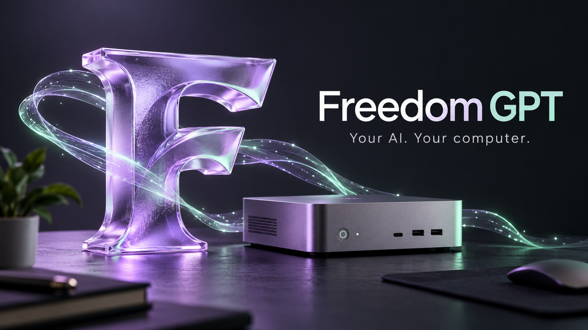

<p align="center"></p>

<h1 align="center">Freedom GPT 💛</h1>
<p align="center"><strong>Бесплатное пространство для локального ИИ, ваших моделей и проектов.</strong></p>
<p align="center"><a href="http://aionpc.ru">🌐 Сайт</a> · <a href="https://github.com/Leongrupp/freedom-gpt/releases/latest">⬇ Скачать</a> · <a href="README.md">🇬🇧 English</a> · <a href="https://t.me/AI1rus">💬 Поддержка в Telegram</a></p>

## ✨ Возможности

- Локальные чаты, потоковый вывод кода, файлы и анализ фото с совместимой визуальной моделью.
- История, папки проектов и память о работе с кодом на вашем диске.
- Скорость генерации, RAM, VRAM и загрузка GPU в интерфейсе.
- Проверка компьютера и поиск моделей в Hugging Face и публичном реестре Ollama.
- Возобновление загрузок и проверка SHA256 моделей.
- Генерация изображений с отдельным комплектом Qwen Image. Видеостудия пока **экспериментальная**, проверка генерации продолжается.
- Русский и английский интерфейс, подписанные обновления между задачами.

**Python, библиотеки агента, Node.js/npm и движки уже включены.** Для локального чата не нужны установленный Python, Ollama или платный API. Веса моделей скачиваются отдельно. Драйверы GPU и дополнительные специализированные инструменты устанавливаются отдельно.

## ⬇ Выберите систему

| Система | Скачать | Требования и статус |
|---|---|---|
| Windows | [Установщик EXE](https://github.com/Leongrupp/freedom-gpt/releases/download/v1.4.2/FreedomGPT-Setup-1.4.2.exe) · [ZIP](https://github.com/Leongrupp/freedom-gpt/releases/download/v1.4.2/FreedomGPT-1.4.2-Windows-x64.zip) | Windows 10/11 x64; проверено на Windows 11 |
| Ubuntu Linux | [Установщик .run](https://github.com/Leongrupp/freedom-gpt/releases/download/v1.4.2/FreedomGPT-Setup-1.4.2-Ubuntu-x64.run) · [DEB](https://github.com/Leongrupp/freedom-gpt/releases/download/v1.4.2/FreedomGPT-1.4.2-Ubuntu-amd64.deb) · [TAR.GZ](https://github.com/Leongrupp/freedom-gpt/releases/download/v1.4.2/FreedomGPT-1.4.2-Ubuntu-x64.tar.gz) | Ubuntu 24.04 x64; чистый контейнер без сети и пробный запуск модели через Linux CUDA |
| Кандидат macOS | [Apple Silicon .app ZIP](https://github.com/Leongrupp/freedom-gpt/releases/download/v1.4.2/FreedomGPT-1.4.2-macOS-AppleSilicon.zip) | **M1+, macOS 26.2+.** Без подписи и нотарификации. Запуск на настоящем Mac ещё не проверен. Intel Mac не включён. |

[Все релизы](https://github.com/Leongrupp/freedom-gpt/releases) · [SHA256](https://github.com/Leongrupp/freedom-gpt/releases/latest/download/SHA256SUMS.txt)

### Windows

Запустите EXE, выберите язык и пустую папку на SSD, затем откройте **FreedomGPT.exe**. Первая проверка предложит модели для компьютера. Скачайте модель, дождитесь проверки, активируйте её и создайте чат.

Можно скачать из PowerShell, открытого в выбранной папке:

```powershell
curl.exe -fL -C - --retry 4 -o FreedomGPT-Setup.exe https://github.com/Leongrupp/freedom-gpt/releases/download/v1.4.2/FreedomGPT-Setup-1.4.2.exe
.\FreedomGPT-Setup.exe
```

### Ubuntu — без установки Python

```sh
curl -fL -C - --retry 4 -o FreedomGPT.run https://github.com/Leongrupp/freedom-gpt/releases/download/v1.4.2/FreedomGPT-Setup-1.4.2-Ubuntu-x64.run
sh FreedomGPT.run
```

Если curl отсутствует, скачайте файл браузером или установите curl из пакетов Ubuntu. Для `.run` не нужен root. Выбор папки: `FREEDOM_INSTALL_DIR=/mnt/ssd/FreedomGPT sh FreedomGPT.run`. Параметр `--install-only` устанавливает без запуска. DEB устанавливается менеджером пакетов.

### macOS — экспериментальный кандидат

Распакуйте ZIP, перенесите **Freedom GPT.app** в Applications и откройте приложение. Внутри Python и движки Metal. Нужны **macOS 26.2+ и Apple Silicon**. Сборка без подписи и нотарификации; требуется проверка на настоящем Mac. Не отключайте защиту системы целиком.

## 🧠 Модели и требования

| Задача | Комплект | Начальный ориентир |
|---|---|---|
| Стандартный код | Huihui Qwen3.8 Coder 27B IQ3_S3 + визуальный проектор | 32 ГБ RAM, NVIDIA 16 ГБ VRAM |
| Изображения | Qwen Image 2.1 Turbo Q5_K_M + энкодер + VAE | Совместимый GPU с достаточной памятью; модели отдельно |
| Лёгкий чат и код | Qwen3.5 4B или 0.8B GGUF | 8–16 ГБ RAM, возможности кода и инструментов ниже |
| Экспериментальное видео | Wan 2.1 T2V 1.3B + энкодер + VAE | Отдельные модели и совместимый GPU; проверка генерации продолжается |

Это оценка памяти, а не гарантия скорости. Длинный контекст требует дополнительную память. На CPU генерация медленнее. У моделей отдельные лицензии. Планируйте **от 35 ГБ свободного SSD** для стандартного комплекта с запасом и **от 45 ГБ** с видео и обновлениями.

## 🔒 Локальная работа и обновления

После скачивания моделей вычисления, история и файлы работают без интернета. Поиск, внешние сайты, загрузки и обновления требуют сети. API приложения и модели слушают **127.0.0.1**.

Обновления проверяют Ed25519 и SHA256, ждут завершения задач и сохраняют модели, чаты и настройки. Для каждой платформы отдельный канал обновлений. Установщик Windows не подписан Authenticode: подпись обновления и сертификат издателя ОС — разные вещи.

Перед отключением SSD остановите приложение. Работа одного физического SSD попеременно на разных ПК пока не проверена. Используйте Git и резервные копии: память модели не заменяет сохранность проекта, код требует проверки.

## 🛠 Развитие

Я развиваю Freedom GPT дальше: более полезный агент, новые модели, понятная установка и **локальная генерация видео**. Видеостудия экспериментальная; ближайшие задачи — закончить реальные проверки генерации и расширить поддержку оборудования.

- [x] Локальные чаты, код, файлы и проекты
- [x] Проверка компьютера и поиск моделей
- [x] Пакеты Windows и Ubuntu
- [ ] Проверка на настоящем Mac, подпись и расширение поддержки macOS
- [ ] Стабилизация видео и улучшение распределения GPU
- [ ] Новые сценарии агента и вклад сообщества

[Сборка](BUILD.md) · [Платформы и границы проверки](CROSS-PLATFORM.md) · [Участие](CONTRIBUTING.md) · [Сообщить об ошибке](https://github.com/Leongrupp/freedom-gpt/issues)

<a id="support-development"></a>
## 💛 Поддержать развитие

Freedom GPT бесплатен. Если приложение помогает, **звезда на GitHub**, отзыв или рассказ друзьям очень поддержат проект. Вопросы и предложения: **[Telegram @AI1rus](https://t.me/AI1rus)**.

Спасибо всем, кто помогает проекту расти. Я ценю каждый вклад 💛

<details><summary>Добровольная поддержка Bitcoin</summary>

Донаты идут на развитие и не открывают платные функции.

**Bitcoin · BTC · основная сеть**

```text
bc1qkkzx7rzx9qace3xvyphcdfy4d5up5k9gzyhdc6
```

</details>

## Лицензии

Код приложения — [MIT](LICENSE). У сторонних компонентов сохранены лицензии и сведения об авторах в [licenses/](licenses/) и [NOTICE](NOTICE). Публичные установщики не содержат личные чаты автора, аккаунты, API-ключи, профили браузера и веса моделей. Для локальных вычислений не нужен платный API; компьютер и электричество используются ваши.

### Проверка видео на Windows (1.4.2)
Wan 2.1 создал ролик 512×288 без звука: 33 кадра, 16 fps, 20 шагов на RTX 4080. Полный цикл с переключением моделей — 50,24 с, сам видеодвижок — 30,76 с. Полное декодирование, локальный HTTP Range и ответ модели кода после возврата GPU проверены. На NVIDIA 16 ГБ для небольших роликов выбирается CUDA VAE; для остальных конфигураций остаётся CPU и возврат на CPU при ошибке выделения памяти. Видео на другом оборудовании и ОС остаётся экспериментальным.
