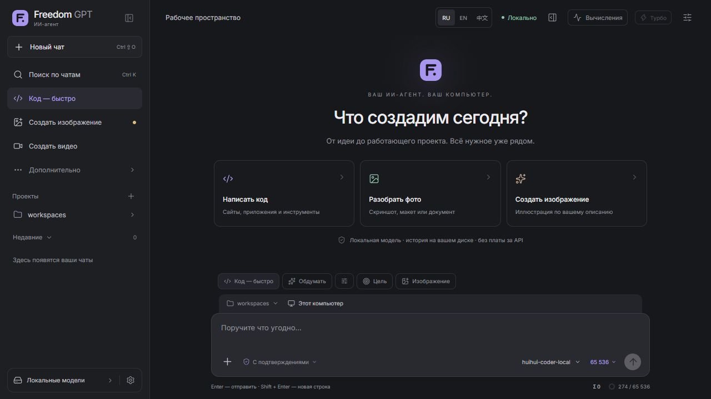
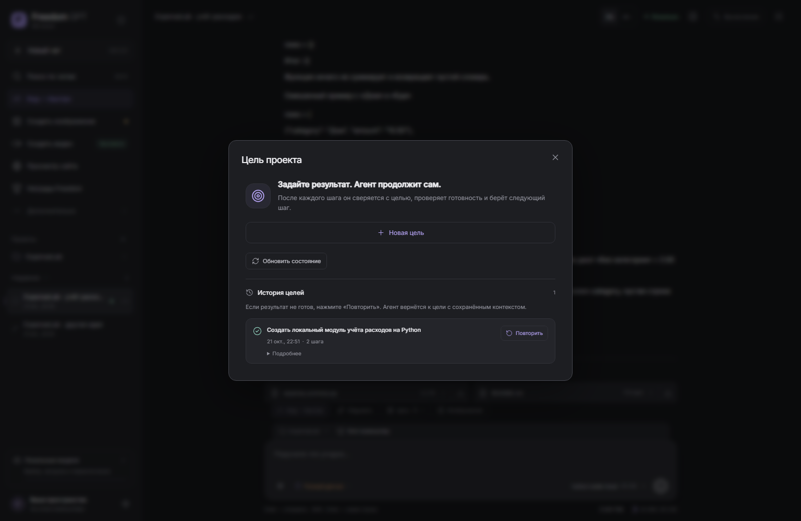
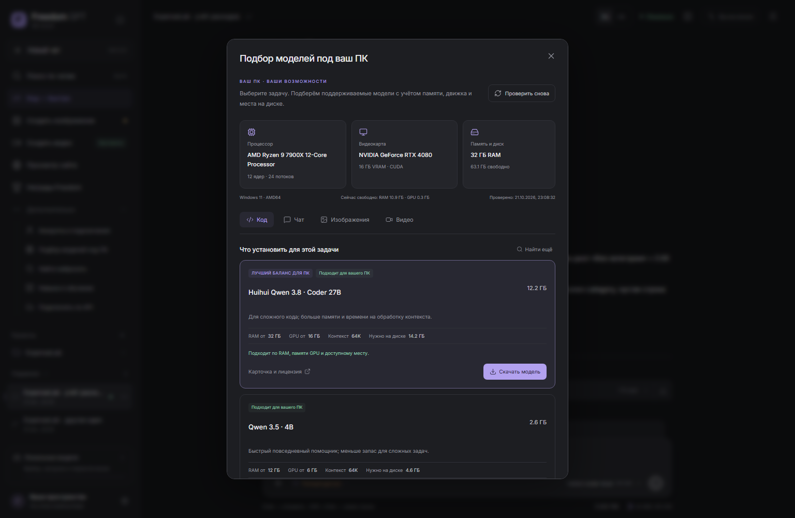

# Freedom GPT · Ваш ИИ-агент. Ваш компьютер.

 

**Русский** · [English](README.md)

> **Готовим Freedom GPT 1.6.0.** Снимки и обзор ниже показывают новую Windows-сборку. Сейчас публично скачивается **1.4.2**, в которой ещё нет всех новых функций. Новые установщики и исходники готовятся к публикации.

Freedom GPT связывает совместимые нейросети, инструменты и память проекта. Поручите результат: агент может править реальные файлы, запускать команды, работать с сайтами и продолжать проект в одном чате.

**Бесплатный агент с открытым кодом.** Локальные запросы без подписки и оплаты за токены. У внешних API собственные тарифы; модели имеют отдельные лицензии.

[🌐 Сайт и скачивание](https://aionpc.ru) · [⬇ Релиз](https://github.com/Leongrupp/freedom-gpt/releases/latest) · [💬 Telegram](https://t.me/AI1rus)

## Компьютер работает. Телефон держит вас в курсе.

Поставьте Freedom GPT на свой ПК: создавайте сайт, разбирайте файлы, исследуйте идеи и рисуйте. В новой версии можно подключить браузер iPhone или Android, открыть те же чаты и отправить задачу, пока компьютер работает. Без приложения из App Store и обязательной регистрации.

[Как подключить телефон](docs/PHONE-ACCESS.md) · [Полный обзор возможностей](docs/FEATURES.ru.md)

### Создали результат — получили новый уровень.

Первый сайт, созданная картинка, миллион обработанных токенов модели: достижения складываются в профиль создателя с опытом, рангами и созвездием навыков. Каждый новый подтверждённый результат добавляется в счётчик. Есть направления для игр, кода, контента, SEO, исследований, аналитики и разрешённых аудитов безопасности. **Freedom сейчас — локальные игровые баллы, без криптовалюты и обещаний дохода.**

## Возможности

- **Код и проекты.** Создавайте сайты и приложения: агент читает и изменяет файлы, работает в терминале и запускает доступные проверки.
- **Цели и очередь.** Поставьте цель с критериями готовности. Добавляйте задания в очередь и передавайте срочную поправку текущей работе.
- **Ветки и память.** Создайте ветку прямо у ответа. В ней сохраняются переписка и файлы, а очередь начинается пустой. Заметки проекта остаются на диске.
- **Браузер рядом с чатом.** Просмотр открывается во время работы агента со страницей. Видны действия и результат; обычные браузеры также доступны через установленные инструменты.
- **Несколько моделей в одном чате.** Выбирайте модели вручную или назначьте автоматический подбор для разных этапов: сценарий, изображения, видео и код.
- **Локально и через API.** Импортируйте совместимый GGUF или подключите поддерживаемые API. GitHub и Hugging Face подключаются по желанию.
- **Модели под ваш ПК.** Проверка CPU, RAM, GPU и свободного места помогает выбрать подходящую модель. Загрузки возобновляются и проверяются по SHA256.
- **Изображения и видео.** Результаты открываются в чате с превью. Локальная генерация требует отдельных моделей; облачное видео поддерживает fal.ai.
- **Турбо с измерением.** Режим сравнивает настройки на этом компьютере и сохраняет профиль ускорения, если он помогает. Переключение ждёт освобождения модели.
- **Контекст и обдумывание.** Выбирайте доступное окно контекста и поддерживаемую глубину обдумывания. Большое окно требует больше памяти и может работать медленнее.
- **Продолжение после ошибок.** При полном доступе агент получает до трёх автоматических продолжений со сменой подхода. Повтор без исправлений блокируется; кнопка «Стоп» действует.
- **Пульт на телефоне.** Включите доступ в настройках и подключите телефон через QR-код. Чаты, файлы и задания доступны в браузере, пока компьютер работает.
- **Награды и уровни.** Достижения, счётчики работ, опыт и игровые баллы Freedom. Это локальные награды, а не выпущенная криптовалюта.
- **Три языка и чистый интерфейс.** Русский, English и 中文, компактные настройки, светлая и тёмная темы. Дополнительные возможности собраны в одном меню.

- **Ответ готов — вы узнаете.** Карточка справа внизу и мягкий короткий звук. Открывайте готовый чат из уведомления; карточки и звук настраиваются отдельно на каждом устройстве. На телефоне страница агента должна быть открыта.

## Текущие публичные загрузки

| Система | Скачать | Требования |
|---|---|---|
| Windows | [EXE](https://github.com/Leongrupp/freedom-gpt/releases/download/v1.4.2/FreedomGPT-Setup-1.4.2.exe) · [ZIP](https://github.com/Leongrupp/freedom-gpt/releases/download/v1.4.2/FreedomGPT-1.4.2-Windows-x64.zip) | Windows 10/11 x64 |
| Ubuntu / Linux | [.run](https://github.com/Leongrupp/freedom-gpt/releases/download/v1.4.2/FreedomGPT-Setup-1.4.2-Ubuntu-x64.run) · [DEB](https://github.com/Leongrupp/freedom-gpt/releases/download/v1.4.2/FreedomGPT-1.4.2-Ubuntu-amd64.deb) · [TAR.GZ](https://github.com/Leongrupp/freedom-gpt/releases/download/v1.4.2/FreedomGPT-1.4.2-Ubuntu-x64.tar.gz) | Ubuntu 24.04+ x64 / compatible glibc 2.39+ |
| macOS | [Apple Silicon .app ZIP](https://github.com/Leongrupp/freedom-gpt/releases/download/v1.4.2/FreedomGPT-1.4.2-macOS-AppleSilicon.zip) | M1+, macOS 26.2+; unsigned / not notarized |
| iPhone / Android | [Подключение телефона](docs/PHONE-ACCESS.md) | Обзор 1.6.0: браузер телефона + работающий ПК |

**Python, Node.js/npm, библиотеки агента и движки уже внутри.** Системный Python и Ollama не нужны. Веса моделей скачиваются отдельно. Git, браузеры автоматизации, Blender и специализированные инструменты устанавливаются отдельно.

[Пошаговая установка](INSTALL.ru.md) · [Проверки и ограничения](VERIFICATION.md) · [Контрольные суммы](https://github.com/Leongrupp/freedom-gpt/releases/latest/download/SHA256SUMS.txt)

## Панели и рабочий процесс

| Цели и история | Подбор моделей |
|---|---|
|  |  |

Снимки выше сделаны в настоящей Windows-версии на нейтральном проекте ExpenseLab. Новые панели 1.6.0 — ниже. Подробности и происхождение снимков: [SCREENSHOTS](docs/SCREENSHOTS.md).

## Начать за три шага

1. Установите сборку для своей системы в папку на SSD.
2. Дождитесь проверки ПК, скачайте подходящую модель или подключите API.
3. Выберите папку проекта и напишите задачу. Для внешних действий настройте разрешения.

## Память, скорость и контроль

Турбо проверяет настройки на вашем компьютере. Универсальных 100 токенов/с или одинакового ускорения на всех моделях не обещаем. Доступный контекст ограничен моделью и памятью: большое окно может переносить вычисления в RAM и снижать скорость. Обдумывание и контекст — разные настройки.

История и память сохраняются локально. Память конечна; точные файлы, Git и резервные копии остаются источником истины. Ссылки, сайты, загрузки и API требуют интернета. Проверка и загрузка обновлений запускаются кнопкой; подписанная установка ждёт завершения задач.

### Эксперименты в персональной Windows-сборке

В локальном Windows-профиле разработчика также развиваются необязательная локальная озвучка, клонирование голоса и камера/аватар. Они дорабатываются отдельно и пока не заявляются как часть текущего публичного установщика.

## Сообщество и развитие

Проект развивается вокруг бесплатного локального агента: больше совместимых моделей, надёжнее инструменты, удобнее работа с ПК и телефоном. Игровые баллы Freedom пока не являются криптовалютой и не обещают обмена или доходности.

[Contributing](CONTRIBUTING.md) · [Support](SUPPORT.md) · [Security](SECURITY.md) · [Build](BUILD.md)

Добровольная поддержка разработки: [страница проекта](https://aionpc.ru/#support). Приложение остаётся бесплатным.

## Лицензии

Исходный код Freedom GPT — MIT. Hermes и другие компоненты сохраняют свои лицензии и сведения об авторах. См. [NOTICE](NOTICE), [LICENSE](LICENSE), [licenses](licenses). Чистые сборки не содержат личных чатов, ключей, моделей и профиля автора.
